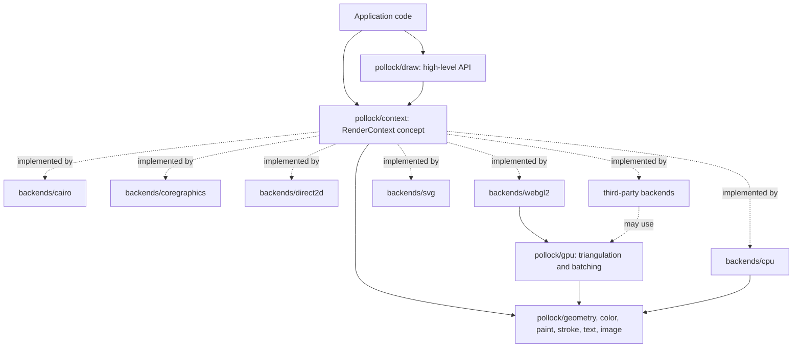

# pollock

## Overview

pollock is an abstract 2D graphics API for Nim, modeled on [linebender/piet](https://github.com/linebender/piet). Code draws against one API (paths, fills, strokes, gradients, clips, transforms, images and text) and a backend turns that into calls to a native renderer. License: BSD-3-Clause. The toolchain is pinned in `mise.toml` (Nim 2.4.0), and Nimble, which ships with Nim, handles the build, tasks and dependencies.

Status: nothing is built yet. This section describes the design the code is meant to follow. As modules land, replace the plan with what the code actually does, and when the code and this file disagree, fix whichever one is wrong in the same change.

Backends shipped in this repository:

| Backend | Platform | Nim target | Native API |
| --- | --- | --- | --- |
| `cairo` | Linux, BSDs (works anywhere Cairo is installed) | `c` | Cairo, with Pango for text |
| `coregraphics` | macOS | `objc`, and `c` through a wrapper | Core Graphics, Core Text |
| `direct2d` | Windows | `c` | Direct2D, DirectWrite, WIC |
| `webgl2` | Browsers | `js` | WebGL2, with Canvas 2D for text rasterization |
| `svg` | Any | `c`, `objc`, `js` | None, writes SVG documents in pure Nim |
| `cpu` | Any | `c`, `objc`, `js` | None, a software rasterizer in pure Nim |

The backend set is open. A backend is any type that satisfies the `RenderContext` concept, so a third-party package (a WebGPU backend, a software rasterizer) plugs in without changes to pollock itself.

### Layers

- Value types (`geometry`, `color`, `paint`, `stroke`) are pure Nim with no backend knowledge. Geometry is the equivalent of piet's kurbo: `Point`, `Vec2`, `Size`, `Rect`, `RoundedRect`, `Circle`, `Ellipse`, `Line`, `Arc`, `Affine` and `BezPath`, all in `float64`. A `Shape` is anything with a `pathElements(tolerance)` iterator; backends check for concrete shape types with `when shape is Rect` and the like to use native fast paths (`CGContextFillRect`, `FillRoundedRectangle`). Geometry also owns curve flattening and stroke expansion (turning a stroked path into the outline to fill), since the CPU backend and `pollock/gpu` both need them.
- `context.nim` holds the `RenderContext` concept: the small set of primitives every backend implements. It is the contract, and it stays small. Anything that can be expressed with the primitives belongs in the high-level API instead.
- `draw.nim` is the high-level API, written once, generic over any `RenderContext`. Convenience shapes and builders, `withSave`/`withTransform`/`withClip` templates, a path DSL, and helpers that take a plain `Color` where the primitive wants a brush. It never calls a backend directly.
- `gpu/` is shared code for backends that rasterize on the GPU themselves: triangulating the flattened outlines from geometry, stencil-then-cover fills for nonzero and even-odd rules, and batching into vertex buffers. WebGL2 is its first user. Keep it free of WebGL types so a WebGPU backend can reuse it.
- `testing.nim` and `samples/` are for backend authors as much as for us: a set of numbered sample scenes every backend renders, plus helpers to compare the output against reference images.
- `pollock.nim` re-exports the core API and the platform's default backend, the way `piet-common` does. The default is Core Graphics on macOS, Direct2D on Windows, WebGL2 under `js`, and Cairo elsewhere. `-d:pollockBackend=<module>` overrides it with any importable module path, including a third-party one; a macro turns the define into the `import`.

### The contract

These rules decide what every backend has to agree on. Changing one is an API change, so update the docs and every backend together.

- Coordinates: origin at the top left, y pointing down, in logical units. A context carries a device scale factor for HiDPI. Core Graphics flips y by default, so its backend applies the flip once when the context is created and never leaks it.
- Color: sRGB. `Color` is straight alpha; images declare their pixel format (RGBA8 straight, RGBA8 premultiplied, and so on) and backends convert. Gradients interpolate in sRGB, since that is what all the native renderers do.
- Device resources: brushes, images and text layouts belong to the backend, because Direct2D brushes and bitmaps are bound to a render target and WebGL textures are bound to a GL context. Each backend declares its own `Brush`, `Image`, `Text` and `TextLayout` types and creates them through the context. The high-level API accepts a backend-independent `Paint` value (a color or a gradient description) and lets the backend cache the device brush for it.
- Errors: drawing calls do not raise (`{.raises: [].}`). A backend records the first failure and reports it from `finish`, the same way Cairo's sticky status works. Losing the device (`D2DERR_RECREATE_TARGET`, a lost WebGL context) is one of those errors, and the caller recreates the context.
- State: `save` and `restore` cover the transform and the clip. Brushes are passed per call, not stored as state.
- Text: a `Text` factory looks up fonts and builds `TextLayout`s with ranged attributes (family, size, weight, style, color, underline). A layout reports its size, line metrics and hit testing. Text is the least portable part, so its API grows only when every backend can implement the addition.

### Targets and platform code

- Everything outside `backends/` must compile under `nim c`, `nim objc` and `nim js`, and so must the `svg` and `cpu` backends. That rules out `ptr`, `addr`, `cast` of memory, `int64` arithmetic that depends on wrapping, and anything from `std/os` that JS lacks. Pixel buffers are `seq[byte]` in the core; the WebGL2 backend converts them to typed arrays.
- Pick code by target with `when defined(js)`, `when defined(objc)`, `when defined(macosx)`, `when defined(windows)`. Keep those branches inside backends and the few core modules that need them, not spread through shared code.
- `cairo`: hand-written FFI to `cairo.h`, `pango.h` and `pangocairo.h`, linked through `pkg-config` in a `{.passl.}`. Bind only what the backend calls.
- `coregraphics`: Core Graphics and Core Text are C APIs, so the drawing itself is plain `importc` and works under both targets. The Objective-C parts (getting a `CGContextRef` from an `NSView` or `NSGraphicsContext`, `CALayer` integration, `NSImage` bridging) live behind one small interface. Under `nim objc` it uses `importobjc` and `{.emit.}` directly; under `nim c` the same interface is a `.m` shim compiled with `{.compile.}` that exposes plain C functions. Both builds go through the same Nim procs, and tests run under both targets.
- `direct2d`: COM interfaces for `ID2D1*` and `IDWrite*` called through their vtables from C. winim covers base COM types and WIC (`winim/inc/wincodec`), but has no Direct2D or DirectWrite bindings, so those are written here. Only call what the backend uses.
- `webgl2`: bindings to `WebGL2RenderingContext` through `importjs`, written here. Shapes go through `pollock/gpu`, antialiasing through a multisampled renderbuffer resolved with `blitFramebuffer`, and text is laid out with Canvas 2D `measureText` and rasterized into a texture on an `OffscreenCanvas`.
- `svg`: builds an SVG document as a string, with no dependencies. Gradients, clips and images go into `<defs>` and are referenced by id. Text is written as `<text>` elements, so layout metrics come from a simple built-in measurer and are approximate; the docs say so.
- `cpu`: a software rasterizer that renders into an RGBA8 premultiplied `seq[byte]`. It fills the flattened outlines from geometry with exact-area coverage accumulation (the approach of font rasterizers like font-rs), applies paints and clips per span, and composites with source-over. It is the reference backend: it runs everywhere, so samples and conformance tests always have one renderer that works on the CI machine at hand. Text needs a font parser and glyph outlines, so it comes after the shape and image work.
- pollock does not open windows or run event loops. Each backend wraps a native context the caller already has (`cairo_t*`, `CGContextRef`, `ID2D1RenderTarget`, an `HTMLCanvasElement`) and also offers an offscreen bitmap target that can be read back to pixels or written to PNG.

### Planned layout

- `src/pollock.nim`: the entry point. Core re-exports and default backend selection.
- `src/pollock/geometry.nim` (a directory once it outgrows one file), `color.nim`, `paint.nim`, `stroke.nim`, `image.nim`, `text.nim`: value types.
- `src/pollock/context.nim`: the `RenderContext` concept.
- `src/pollock/draw.nim`: the high-level API.
- `src/pollock/dyn.nim`: an optional type-erased context (a table of closures built from any `RenderContext`) for code that has to pick a backend at runtime. Static dispatch through the concept is the default.
- `src/pollock/gpu/`: shared GPU tessellation.
- `src/pollock/recording.nim`: a backend that records calls into a list. Tests use it to check the high-level API without a native renderer.
- `src/pollock/backends/<name>.nim`, with FFI and shims in `src/pollock/backends/<name>/`.
- `src/pollock/samples/` and `src/pollock/testing.nim`: the sample scenes and the conformance helpers.

## Building and testing

- Nim comes from mise through the vfox-nim plugin. Register the plugin once with `mise plugin install nim https://github.com/elijahr/vfox-nim`, then run `mise install`. Do not install Nim another way (choosenim, Homebrew) alongside it.
- Keep the package manifest in `pollock.nimble` at the root, so `nimble build` and `nimble test` are the main commands anyone needs to remember. Nimble's built-in `test` runs every `tests/t*.nim`; add a task only for a step it doesn't cover (running the tests under `js` and `objc`, rendering the samples). Pin dependencies in `nimble.lock` (`nimble lock`) and commit it.
- Tests live in `tests/`, one `t*.nim` file per area, using `std/unittest`. Add a test with every behavior change. Core tests run under `c` and `js` (`nim js -d:nodejs -r`). Backend tests skip themselves with `when` on platforms where the backend can't run.
- Rendering is checked with the samples: every backend renders each sample to a bitmap, and the test compares it with `tests/golden/<backend>/<sample>.png` within a tolerance, since antialiasing differs between renderers. The `cpu` backend must match its goldens exactly, since it is deterministic. The `svg` backend's goldens are `.svg` files compared as text. Regenerate a golden only on purpose, look at the new image, and say why in the commit.
- Run `nim check` on a file for fast type errors without a full build. Backends for other platforms can be type-checked from any machine: `nim check --os:windows src/pollock/backends/direct2d.nim`, `nim check --os:linux src/pollock/backends/cairo.nim`, `nim js` for WebGL2. Do this whenever you touch a backend you can't run locally.
- CI runs the tests on Linux (Cairo), macOS (Core Graphics under `c` and `objc`), Windows (Direct2D) and headless Chromium (WebGL2). The `svg` and `cpu` tests run on all of them.
- Compiler settings that apply to the whole project go in `config.nims` at the root, not in flags scattered across scripts.

## Searching the Codebase

Use fast, modern tools instead of the slow defaults:

- [`rg`](https://github.com/BurntSushi/ripgrep) (ripgrep) for text search, not `grep`. It respects `.gitignore` for you.
- [`fd`](https://github.com/sharkdp/fd) for finding files by name, not `find`.
- [`ast-grep`](https://ast-grep.github.io) for structural searches and rewrites in languages it supports. It has no built-in Nim grammar, so use `rg` for Nim sources. Call it as `ast-grep`. The `sg` alias is deprecated, so don't use it.
- `jq` for reading and querying JSON.

If your harness has dedicated search or file tools that already wrap these, those are fine too.

## Code Quality

Always lint and format:

- Format with [`nph`](https://github.com/arnetheduck/nph), not `nimpretty`. Run `nph src tests` before committing.
- Build with `--styleCheck:error` (set it in `config.nims`) so identifiers keep one spelling across the codebase. Nim's style insensitivity is not an excuse for `fooBar` in one file and `foo_bar` in another. FFI names keep the C spelling through `importc: "cairo_fill"` while the Nim name follows Nim style.
- Treat compiler warnings and hints about unused imports or variables as things to fix, not noise.

Use modern code practices:

- Nim 2 defaults: ORC memory management, `strictDefs`, and `std/` prefixed imports (`import std/[math, options]`).
- Prefer `func` for procs without side effects (all of geometry should be `func`), exception-tracked error handling with `{.raises: [].}` on the drawing primitives, and `distinct` types over bare primitives for things that should not mix.
- Native handles are owned by Nim objects with `=destroy` hooks (release the COM pointer, `cairo_destroy`, `CFRelease`), and `=copy` is disabled for them unless the handle is reference counted and the copy retains it.
- Keep the concept small and generic code static. Reach for `dyn.nim` only where runtime choice is the point.
- Reach for the standard library before adding a dependency.

## Docs (IMPORTANT!!!)

Always update the docs if necessary when changing or adding code. If the docs already contain outdated information, expand your scope to cover that info too. That includes this file: when the layout, build, backends or tooling change, update the overview and the build section here.

The docs are a [Zensical](https://zensical.org) site: `zensical.toml` at the root, pages in `docs/`. Set it up with the first code. `zensical build --strict` checks it and writes `site/` (ignored by git), and `zensical serve` previews it. A Docs workflow runs the strict build on pull requests that touch the docs, and a Pages workflow publishes the site on every push to `main` that does. Planned pages:

- `index.md`: what pollock is, with an example.
- `getting-started.md`: installing, the system libraries each backend needs, a first drawing to a PNG and into a window.
- `drawing.md`: the high-level API. Every exported proc and template in `draw.nim` gets an entry.
- `context.md`: the `RenderContext` primitives and the contract rules above.
- `backends.md`: one section per backend, covering how to wrap a native context, its quirks and what it doesn't support yet.
- `writing-a-backend.md`: implementing the concept in a separate package, using `pollock/gpu`, and running the samples against it.
- `architecture.md` and `development.md`: for people working on pollock.
- `roadmap.md`: what's done and what's planned.

Compile the examples you put in the docs before committing them.

When a roadmap item is finished, check it off (`- [x]`) where it is. DO NOT move it into an earlier section like "Done: the MVP". The roadmap shows how each goal is progressing, so finished items stay with the section they belong to.

The README is only an entry point: what pollock is, one example, installing, and links into the docs. Put details in the docs, not the README.

## Diagrams as Mermaid, not ASCII art

Never draw a flow, pipeline or architecture picture out of characters in a code block. Make a Mermaid diagram instead.

## Outdated packages

PLEASE, PLEASE do not use a package that is old or deprecated. EVEN IF IT IS "INDUSTRY STANDARD" THAT DOES NOT MEAN IT IS GOOD!!! USE THE BEST PACKAGE AND LATEST VERSION LIKE A NORMAL PERSON WOULD!

Check the package's repository for its latest release tag (and whether it is still maintained) before adding it to or bumping it in `pollock.nimble`. The Nimble package list (`nimble search <name>`) points to the repository. The same goes for native APIs: target current ones (Direct2D 1.1 device contexts, not the old `ID2D1HwndRenderTarget` path, if it fits; WebGL2, not WebGL1 fallbacks).

## Keep things human

Do not use em dashes or other special symbols not normally found in writing. Do not word things in a weird way. Keep it looking human. If you need to use, for example, an arrow icon, use an SVG instead.

Replacing an em dash with a hyphen is NOT a fix. A spaced hyphen doing an em dash's job ("the limit - 4 bytes", "fast - but wrong") is the same tic with a different character. Reword the sentence instead: use a comma, a colon, parentheses, or the actual word ("minus", "to", "through"). Plain hyphens in compound words and numeric ranges like 0-1 are fine.

## Use American spelling

It's fine to be British in the chat if the person is actually in a region where it's spelled like that. But if not, just use American spelling. The thing itself MUST use American spelling.
