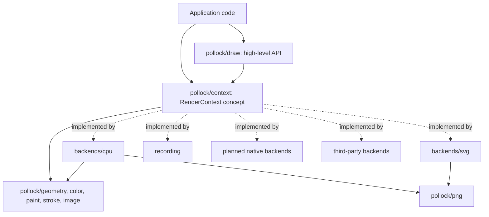

# pollock

## Overview

pollock is an abstract 2D graphics API for Nim, modeled on [linebender/piet](https://github.com/linebender/piet). Code draws against one API (paths, fills, strokes, gradients, clips, transforms and images; text is planned) and a backend turns that into calls to a renderer. License: BSD-3-Clause. The toolchain is pinned in `mise.toml` (Nim 2.4.0, nph 0.7.0), and Nimble, which ships with Nim, handles the build, tasks and dependencies. There are no dependencies beyond the standard library.

Backends:

| Backend | Module | Target | Status |
| --- | --- | --- | --- |
| `cpu` | `pollock/backends/cpu` | `c`, `objc`, `js` | done, no text. The reference renderer. |
| `svg` | `pollock/backends/svg` | `c`, `objc`, `js` | done, no text |
| `recording` | `pollock/recording` | any | done; records the calls, for tests |
| `cairo` | `pollock/backends/cairo` | `c` | planned: Cairo with Pango for text |
| `coregraphics` | `pollock/backends/coregraphics` | `objc`, and `c` through a wrapper | planned: Core Graphics, Core Text |
| `direct2d` | `pollock/backends/direct2d` | `c` | planned: Direct2D, DirectWrite, WIC |
| `webgl2` | `pollock/backends/webgl2` | `js` | planned: WebGL2, Canvas 2D for text |

The backend set is open. A backend is any type that satisfies the `RenderContext` concept, so a third-party package (a WebGPU backend, say) plugs in without changes to pollock itself.

### Layers

Modules in `src/`:

- `pollock.nim`: the entry point. Re-exports `draw` and `png` and imports one backend, the one named by the `pollockBackend` define (default `pollock/backends/cpu`; any module path works, including one from another package). A macro turns the define into the `import` and `export`.
- `pollock/geometry.nim`: `Point`, `Vec2`, `Size`, `Rect`, `RoundedRect`, `Circle`, `Ellipse`, `Line`, `Affine`, `PathEl`, `BezPath`, `Polyline`, all in `float64`, and the `Shape` concept (`toPath` and `boundingBox`). Also flattening (`flatten`, Wang's formula for the segment count; a subpath that is only a `moveTo` is dropped, a zero-length one is kept so strokes draw it as a dot), `signedArea`, `area` and `polygonPath`. `boundingBox` of a path is the box around the control points, not the exact curve.
- `pollock/color.nim`: `Color` (sRGB, straight alpha, 0..1), `Rgba8`, hex parsing and formatting, premultiplication, `lerp`, named constants.
- `pollock/paint.nim`: `Paint` (solid, linear gradient, radial gradient), `GradientStop`, `Extend`, `colorAt` and `applyExtend` for evaluating gradients. `Paint` is a case object, so it has a hand-written `==`; so does `PathEl`.
- `pollock/stroke.nim`: `StrokeStyle` (width, caps, joins, miter limit, dashes) and stroke expansion. `dash` splits polylines by a pattern (zero-length on entries become two-point dashes that stroke as dots, zero-length gaps keep the line whole); `strokeOutline` turns a path into a union of pieces (one quad per segment, join and cap pieces) that all wind the same way, so a nonzero fill gives the stroke. Backends with native stroking pass the style through; the CPU backend fills the outline.
- `pollock/image.nim`: `ImageData` (`ifGray8`, `ifRgb8`, `ifRgba8`, `ifRgba8Premul`), pixel get and set as `Color`, `convert`.
- `pollock/context.nim`: the `RenderContext` concept with its ten primitives, `FillRule`, `Interpolation`, `RenderResult`, and the contract rules in its module comment. Re-exports the value-type modules so a backend imports one thing.
- `pollock/draw.nim`: the high-level API, generic over `C: RenderContext`: `fill`, `stroke`, `clip` for any `Shape`, with `Color` overloads; `translate`, `scale`, `rotate`, `rotateAbout`; `drawImage` helpers; the templates `withSave`, `withTransform`, `withClip`. The `drawImage` helpers need `mixin drawImage` because they share a name with the primitive.
- `pollock/recording.nim`: `RecordingContext`, which stores `Command`s.
- `pollock/png.nim`: a PNG codec with no dependencies. The encoder writes stored deflate blocks; the decoder has a full inflate (stored, fixed and dynamic Huffman) and handles 8-bit gray, RGB, palette, gray+alpha and RGBA without interlacing. `writePng` and `readPng` exist off the JS target.
- `pollock/samples.nim`: the sample scenes (`sampleNames`, `drawSample`), plus `checkerboard`, `starPath` and `pentagramPath` (self-intersecting, for fill-rule tests).
- `pollock/testing.nim`: `compareImages` for golden tests and for backend authors.
- `pollock/backends/cpu.nim`: `CpuContext`. Premultiplied RGBA `float32` pixels. Paths are transformed to device space, flattened, and accumulated as exact signed-area coverage (after font-rs) in a buffer with `width + 2` cells per row; edges are split at the left and right borders and the outside parts become vertical edges on the border so their winding still counts. Only the columns the shape's bounds touch are cleared and scanned. A `Shader` is a paint resolved for one fill (solid, gradient or image with the inverse transform); a linear gradient with no length or a radial one with no radius becomes a solid of the last stop, as SVG specifies. Clips are immutable coverage masks shared through the save stack. Strokes are expanded in user space with the tolerance divided by `Affine.maxScale` (the largest stretch, so non-uniform transforms stay smooth), then filled. `toImage` and `pixel` read the result back.
- `pollock/backends/svg.nim`: `SvgContext`. One element per primitive with the transform as a `matrix(...)` attribute; gradients in `<defs>` with `userSpaceOnUse`; a clip opens a `<g clip-path>` and the save stack records how many groups each level opened so `restore` closes the right number; images as PNG data URIs. Numbers keep about seven significant digits (never fewer than three decimals), so small transform coefficients survive. A miter limit below 1 is written as a bevel join, since SVG ignores it. `toSvg` returns the document.

### The contract

These rules decide what every backend has to agree on. Changing one is an API change, so update `docs/context.md` and every backend together.

- Coordinates: origin at the top left, y pointing down, in logical units. Positive rotation is clockwise on screen. Core Graphics flips y by default, so its backend will apply the flip once when the context is created and never leak it.
- Color: sRGB. `Color` is straight alpha; images declare their pixel format and backends convert. Gradients interpolate in sRGB with straight alpha, since that is what all the native renderers do.
- Paints are values. A backend may build device resources (Direct2D brushes, WebGL textures) from them and cache those.
- Errors: drawing calls do not raise. A backend records the first failure and reports it from `finish`, the same way Cairo's sticky status works. Losing the device is one of those errors, and the caller recreates the context.
- State: `save` and `restore` cover the transform and the clip. Paints are passed per call, not stored as state.
- `clear` paints the whole target and ignores the transform and the clip.
- The primitives are named `fillPath`, `strokePath` and `clipPath`, and the generic helpers in `draw.nim` are `fill`, `stroke` and `clip`, so the concept never matches the helpers. Keep it that way when adding primitives: a primitive and a helper must not share a name unless the helper uses `mixin`.
- Text: planned. A `Text` factory will build `TextLayout`s with ranged attributes, and the API grows only when every backend can implement the addition.

### Targets and platform code

- Everything in `src/` must compile under `nim c`, `nim objc` and `nim js`, and the tests run under `c` and `js` (`nimble testjs`). That rules out `ptr`, `addr` and `cast` of memory in the core and the pure-Nim backends. Pixel buffers are `seq[uint8]` and `seq[float32]`. File I/O goes behind `when not defined(js)`.
- The JS backend evaluates a `case` selector once per branch. Bind a selector with side effects to a `let` first (`png.nim` does this for the deflate block type). Unsigned arithmetic and `shl`/`shr` on `uint32` behave the same on both targets.
- Pick code by target with `when defined(js)`, `when defined(objc)`, `when defined(macosx)`, `when defined(windows)`. Keep those branches inside backends and the few core modules that need them.
- Planned native backends, so the shape is settled before they are written:
  - `cairo`: hand-written FFI to `cairo.h`, `pango.h` and `pangocairo.h`, linked through `pkg-config` in a `{.passl.}`. Bind only what the backend calls.
  - `coregraphics`: Core Graphics and Core Text are C APIs, so the drawing is plain `importc` and works under both targets. The Objective-C parts (getting a `CGContextRef` from an `NSView` or `NSGraphicsContext`, `CALayer` integration, `NSImage` bridging) live behind one small interface: `importobjc` and `{.emit.}` under `nim objc`, a `.m` shim compiled with `{.compile.}` under `nim c`. Both builds go through the same Nim procs, and tests run under both targets.
  - `direct2d`: COM interfaces for `ID2D1*` and `IDWrite*` called through their vtables from C. winim covers base COM types and WIC but has no Direct2D or DirectWrite bindings, so those are written here.
  - `webgl2`: bindings to `WebGL2RenderingContext` through `importjs`. Shapes go through a shared `pollock/gpu` layer (triangulating flattened outlines, stencil-then-cover fills, batching) kept free of WebGL types so a WebGPU backend can reuse it; antialiasing through a multisampled renderbuffer resolved with `blitFramebuffer`; text laid out with Canvas 2D `measureText` and rasterized into a texture on an `OffscreenCanvas`.
- pollock does not open windows or run event loops. Each backend wraps a native target the caller already has, or an offscreen one of its own.

## Building and testing

- Nim comes from mise through the vfox-nim plugin. Register the plugin once with `mise plugin install nim https://github.com/elijahr/vfox-nim`, then run `mise install`. Do not install Nim another way (choosenim, Homebrew) alongside it.
- Keep the package manifest in `pollock.nimble` at the root. `nimble test` runs every `tests/t*.nim` under the C target; the tasks there are `testjs` (the same under `nim js` with Node), `samples` (renders every scene with every backend into `out/`, through `tools/rendersamples.nim`) and `goldens` (rewrites `tests/golden/`). Add a task only for a step those don't cover. When a dependency ever appears, pin it in `nimble.lock` (`nimble lock`) and commit it.
- Tests live in `tests/`, one `t*.nim` file per area, using `std/unittest`. `tests/config.nims` puts `src/` on the path. Add a test with every behavior change. Tests that touch files skip themselves under JS with `when not defined(js)`.
- Rendering is checked with the samples in `tsamples.nim`: every backend renders each scene and the test compares it with `tests/golden/cpu/<name>.png` (exact, since the CPU backend is deterministic) and `tests/golden/svg/<name>.svg` (as text; `.gitattributes` keeps them LF on Windows checkouts). Regenerate a golden only on purpose with `nimble goldens`, look at the new files, and say why in the commit. When adding a scene, add it to `sampleNames` and `drawSample` and commit its goldens.
- Run `nim check` on a file for fast type errors without a full build. Backends for other platforms can be type-checked from any machine: `nim check --os:windows ...`, `nim check --os:linux ...`, `nim js` for WebGL2. Do this whenever you touch a backend you can't run locally.
- CI (`.github/workflows/ci.yml`) runs `nimble test`, `nimble testjs` and `nimble samples` on Linux, macOS and Windows and checks `nph --check`. Native backends will add platform jobs (Linux for Cairo, macOS for Core Graphics under `c` and `objc`, Windows for Direct2D, headless Chromium for WebGL2).
- Compiler settings that apply to the whole project go in `config.nims` at the root, not in flags scattered across scripts.

## Searching the Codebase

Use fast, modern tools instead of the slow defaults:

- [`rg`](https://github.com/BurntSushi/ripgrep) (ripgrep) for text search, not `grep`. It respects `.gitignore` for you.
- [`fd`](https://github.com/sharkdp/fd) for finding files by name, not `find`.
- [`ast-grep`](https://ast-grep.github.io) for structural searches and rewrites in languages it supports. It has no built-in Nim grammar, so use `rg` for Nim sources. Call it as `ast-grep`. The `sg` alias is deprecated, so don't use it.
- `jq` for reading and querying JSON.

If your harness has dedicated search or file tools that already wrap these, those are fine too.

## Code Quality

Always lint and format:

- Format with [`nph`](https://github.com/arnetheduck/nph), not `nimpretty`. Run `nph src tests tools` before committing; CI rejects unformatted code.
- Build with `--styleCheck:error` (set in `config.nims`) so identifiers keep one spelling across the codebase. Nim's style insensitivity is not an excuse for `fooBar` in one file and `foo_bar` in another. FFI names keep the C spelling through `importc: "cairo_fill"` while the Nim name follows Nim style.
- Treat compiler warnings and hints about unused imports or variables as things to fix, not noise.

Use modern code practices:

- Nim 2 defaults: ORC memory management, `strictDefs`, and `std/` prefixed imports (`import std/[math, strutils]`).
- Prefer `func` for procs without side effects (all of geometry is `func`), exception-tracked error handling with `{.raises: [].}` where it matters, and `distinct` types over bare primitives for things that should not mix.
- Native handles are owned by Nim objects with `=destroy` hooks (release the COM pointer, `cairo_destroy`, `CFRelease`), and `=copy` is disabled for them unless the handle is reference counted and the copy retains it.
- Keep the concept small and generic code static. A type-erased context is on the roadmap for code that has to pick a backend at runtime; static dispatch through the concept is the default.
- Every backend ends with `static: doAssert X is RenderContext`, so a missing proc fails in the backend's own module.
- Reach for the standard library before adding a dependency.

## Docs (IMPORTANT!!!)

Always update the docs if necessary when changing or adding code. If the docs already contain outdated information, expand your scope to cover that info too. That includes this file: when the layout, build, backends or tooling change, update the overview and the build section here.

The docs are a [Zensical](https://zensical.org) site: `zensical.toml` at the root, pages in `docs/`. `uvx zensical build --strict` checks it and writes `site/` (ignored by git), and `uvx zensical serve` previews it. The Docs workflow runs the strict build on pull requests that touch the docs, and the Pages workflow publishes the site on every push to `main` that does. Pages:

- `index.md`: what pollock is, with an example.
- `getting-started.md`: installing, a first drawing to a PNG and to SVG, generic drawing code, choosing the default backend.
- `drawing.md`: the high-level API. Every exported proc and template in `draw.nim` gets an entry, and the shapes, paints and stroke styles they take.
- `context.md`: the `RenderContext` primitives and the contract rules above. Keep it in step with `context.nim`.
- `backends.md`: one section per backend, covering how to make one, its quirks and what it doesn't support yet, and the plan for the native ones.
- `writing-a-backend.md`: implementing the concept in a separate package, what pollock provides, running the samples against it.
- `architecture.md` and `development.md`: for people working on pollock.
- `roadmap.md`: what's done and what's planned.

Compile the examples you put in the docs before committing them.

When a roadmap item is finished, check it off (`- [x]`) where it is. DO NOT move it into an earlier section like "Done: the MVP". The roadmap shows how each goal is progressing, so finished items stay with the section they belong to.

The README is only an entry point: what pollock is, one example, building, and links into the docs. Put details in the docs, not the README.

## Diagrams as Mermaid, not ASCII art

Never draw a flow, pipeline or architecture picture out of characters in a code block. Make a Mermaid diagram instead.

## Outdated packages

PLEASE, PLEASE do not use a package that is old or deprecated. EVEN IF IT IS "INDUSTRY STANDARD" THAT DOES NOT MEAN IT IS GOOD!!! USE THE BEST PACKAGE AND LATEST VERSION LIKE A NORMAL PERSON WOULD!

Check the package's repository for its latest release tag (and whether it is still maintained) before adding it to or bumping it in `pollock.nimble`. The Nimble package list (`nimble search <name>`) points to the repository. The same goes for GitHub Actions in the workflows and for native APIs: target current ones (Direct2D 1.1 device contexts rather than the old `ID2D1HwndRenderTarget` path if it fits; WebGL2, not WebGL1 fallbacks).

## Keep things human

Do not use em dashes or other special symbols not normally found in writing. Do not word things in a weird way. Keep it looking human. If you need to use, for example, an arrow icon, use an SVG instead.

Replacing an em dash with a hyphen is NOT a fix. A spaced hyphen doing an em dash's job ("the limit - 4 bytes", "fast - but wrong") is the same tic with a different character. Reword the sentence instead: use a comma, a colon, parentheses, or the actual word ("minus", "to", "through"). Plain hyphens in compound words and numeric ranges like 0-1 are fine.

## Use American spelling

It's fine to be British in the chat if the person is actually in a region where it's spelled like that. But if not, just use American spelling. The thing itself MUST use American spelling.
