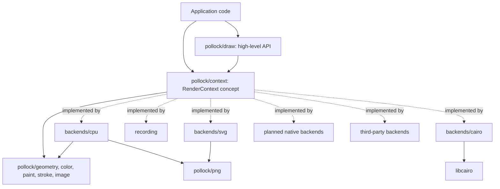

# pollock

## Overview

pollock is an abstract 2D graphics API for Nim, modeled on [linebender/piet](https://github.com/linebender/piet). Code draws against one API (paths, fills, strokes, gradients, clips, transforms and images; text is planned) and a backend turns that into calls to a renderer. License: BSD-3-Clause. The toolchain is pinned in `mise.toml` (Nim 2.4.0, nph 0.7.0), and Nimble, which ships with Nim, handles the build, tasks and dependencies. The library has no dependencies beyond the standard library. The examples' native window uses the official `sdl3` package, a development dependency only (see Building and testing).

Backends:

| Backend | Module | Target | Status |
| --- | --- | --- | --- |
| `cpu` | `pollock/backends/cpu` | `c`, `objc`, `js` | done, no text. The reference renderer. |
| `svg` | `pollock/backends/svg` | `c`, `objc`, `js` | done, no text |
| `recording` | `pollock/recording` | any | done; records the calls, for tests |
| `cairo` | `pollock/backends/cairo` | `c`, `objc` | done, no text (Pango is the plan). Needs Cairo through `pkg-config`. Not NimScript: the VM can't call C, so importing it there is a compile error. |
| `coregraphics` | `pollock/backends/coregraphics` | `objc`, and `c` through a wrapper | planned: Core Graphics, Core Text |
| `direct2d` | `pollock/backends/direct2d` | `c` | planned: Direct2D, DirectWrite, WIC |
| `webgl2` | `pollock/backends/webgl2` | `js` | planned: WebGL2, text through a glyph atlas |

The backend set is open. A backend is any type that satisfies the `RenderContext` concept, so a third-party package (a WebGPU backend, say) plugs in without changes to pollock itself. Text engines will be a second open set that combines freely with the backends (see the text line in the contract).

### Layers

Modules in `src/`:

- `pollock.nim`: the entry point. Re-exports `draw` and `png` and imports one backend, the one named by the `pollockBackend` define (default `pollock/backends/cpu`; any module path works, including one from another package). A macro turns the define into the `import` and `export`.
- `pollock/geometry.nim`: `Point`, `Vec2`, `Size`, `Rect`, `RoundedRect`, `Circle`, `Ellipse`, `Line`, `Affine`, `PathEl`, `BezPath`, `Polyline`, all in `float64`, and the `Shape` concept (`toPath` and `boundingBox`). Also flattening (`flatten`, Wang's formula for the segment count; a subpath that is only a `moveTo` is dropped, a zero-length one is kept so strokes draw it as a dot), `signedArea`, `area` and `polygonPath`. `boundingBox` of a path is the box around the control points, not the exact curve.
- `pollock/color.nim`: `Color` (sRGB, straight alpha, 0..1), `Rgba8`, hex parsing and formatting, premultiplication, `lerp`, named constants.
- `pollock/paint.nim`: `Paint` (solid, linear gradient, radial gradient), `GradientStop`, `Extend`, `colorAt` and `applyExtend` for evaluating gradients. `Paint` is a case object, so it has a hand-written `==`; so does `PathEl`.
- `pollock/stroke.nim`: `StrokeStyle` (width, caps, joins, miter limit, dashes) and stroke expansion. `dash` splits polylines by a pattern (zero-length on entries become two-point dashes that stroke as dots, zero-length gaps keep the line whole); `strokeOutline` turns a path into a union of pieces (one quad per segment, join and cap pieces) that all wind the same way, so a nonzero fill gives the stroke. Backends with native stroking pass the style through; the CPU backend fills the outline.
- `pollock/image.nim`: `ImageData` (`ifGray8`, `ifRgb8`, `ifRgba8`, `ifRgba8Premul`), pixel get and set as `Color`, `convert`.
- `pollock/context.nim`: the `RenderContext` concept with its ten primitives, `FillRule`, `Interpolation`, `RenderResult`, and the contract rules in its module comment. Re-exports the value-type modules so a backend imports one thing.
- `pollock/draw.nim`: the high-level API, generic over `C: RenderContext`: `fill`, `stroke`, `clip` for any `Shape`, with `Color` overloads; `translate`, `scale`, `rotate`, `rotateAbout`; `drawImage` helpers; the templates `withSave`, `withTransform`, `withClip`. The `drawImage` helpers need `mixin drawImage` because they share a name with the primitive.
- `pollock/recording.nim`: `RecordingContext`, which stores `Command`s.
- `pollock/png.nim`: a PNG codec with no dependencies. The encoder writes stored deflate blocks; the decoder has a full inflate (stored, fixed and dynamic Huffman) and handles 8-bit gray, RGB, palette, gray+alpha and RGBA without interlacing. Malformed input raises `PngError`, never a defect: the IHDR length and dimensions are checked, and `inflate` takes a `maxOutput` that the decoder sets to the size the header implies, so a small file can't expand into gigabytes. `writePng` and `readPng` exist off the JS target.
- `pollock/samples.nim`: the sample scenes (`sampleNames`, `drawSample`), plus `checkerboard`, `starPath` and `pentagramPath` (self-intersecting, for fill-rule tests).
- `pollock/testing.nim`: `compareImages` for golden tests and for backend authors.
- `pollock/backends/cpu.nim`: `CpuContext`. Premultiplied RGBA `float32` pixels. Paths are transformed to device space, flattened, and accumulated as exact signed-area coverage (after font-rs) in a buffer with `width + 2` cells per row; edges are split at the left and right borders and the outside parts become vertical edges on the border so their winding still counts. Only the columns the shape's bounds touch are cleared and scanned. A `Shader` is a paint resolved for one fill (solid, gradient or image with the inverse transform); a linear gradient with no length or a radial one with no radius becomes a solid of the last stop, as SVG specifies. Clips are immutable coverage masks shared through the save stack. Strokes are expanded in user space with the tolerance divided by `Affine.maxScale` (the largest stretch, so non-uniform transforms stay smooth), then filled. `toImage` and `pixel` read the result back.
- `pollock/backends/svg.nim`: `SvgContext`. One element per primitive with the transform as a `matrix(...)` attribute; gradients in `<defs>` with `userSpaceOnUse`; a clip opens a `<g clip-path>`, and the state keeps the ids of the open groups so `restore` closes the ones its level opened and `clear` can close them all around its rectangle and reopen them (so `clear` ignores the clip, as the contract says); images as PNG data URIs. Numbers are rounded to about seven significant digits, never more coarsely than to three decimal places, with trailing zeros removed, so small transform coefficients survive. A miter limit below 1 is written as a bevel join, since SVG ignores it. `toSvg` returns the document.
- `pollock/backends/cairo.nim`: `CairoContext`, over libcairo. Hand-written bindings for only the calls it makes (`importc` with `header: "cairo.h"`, opaque `ptr` handle types, enum values as `cint` constants); the flags come from `pkg-config --cflags cairo` and `pkg-config --libs cairo` through `gorgeEx` at compile time, and a missing Cairo is a compile error. `newCairoContext(width, height)` owns an offscreen ARGB32 image surface that `toImage` and `pixel` read back; `newCairoContext(cr: pointer)` wraps a `cairo_t` from any binding and takes a reference, with the cairo_t's matrix at that moment as the base of pollock's user space. `=destroy` releases the handles and `=copy` is disabled. The transform is mirrored in Nim and set on the cairo_t before every drawing call so a singular or non-finite one is skipped instead of putting the cairo_t into its permanent error state; each drawing call runs inside a save/restore pair so a wrapped cairo_t keeps its owner's matrix and settings, and `=destroy` pops any unrestored `save`; `toImage` and `pixel` read the owned surface (not `cairo_get_target`, which has no pixels once the cairo_t fails) and handle ARGB32 and RGB24 targets only; the clip is Cairo's, through `cairo_save` and `cairo_restore`; `clear` resets the clip inside a save/restore pair and paints with the `SOURCE` operator. Quadratic curves become cubics, degenerate gradients paint their last stop without relying on Cairo, dash entries are clamped to zero (Cairo rejects negatives), and images are copied into an ARGB32 surface and painted as a pattern with `EXTEND_PAD`. Cairo's errors are sticky: `finish` reports the first one and the caller makes a new context.

Examples in `examples/` (not part of the package; `examples/config.nims` puts `src/` on the path):

- `scene.nim`: what the scenes share. The scene size (640 by 400, `sceneBounds`), `Input` (the pointer in scene coordinates: `pos`, `inside`, `down`, `pressed` for the frame a press starts), and helpers (`hsl`, `polar`, `approach` for frame-rate-independent smoothing, `wrapAngle`). A scene is an object with `update(s: var T, dt, input)` and `render[C: RenderContext](s: T, ctx: var C)`; `render` covers the whole scene with an opaque background first, since hosts don't clear.
- `orrery.nim`, `fireworks.nim`, `beziers.nim`, `gears.nim`, `flowfield.nim`: the five scenes. Simulations seed their own `Rand` so a run repeats exactly.
- `scenes.nim`: `SceneKind`, a `Scene` case object over all of them, with `name`, `title`, `hint` (what the pointer does), `newScene`, `update` and `render`. A new scene goes here.
- `window.nim`: the host. Opens a resizable high-density window with `sdl3` (imported `except Point, Rect`, which clash with pollock's), maps the scene into it with a view transform and paints letterbox bars over the edges afterward (cheaper than a clip on the CPU backend), draws with `CpuContext` (or `CairoContext` under `-d:pollockCairo`), uploads `toImage` into a streaming `PIXELFORMAT_RGBA32` texture, and presents with vsync. Draws at the window's size in points by default, since the CPU backend is too slow for every pixel of a Retina screen at 60 fps; H switches. `window.nims` links SDL3 with the flags from `pkg-config --libs sdl3` and `--dynlibOverride:SDL3` when pkg-config knows it, because the package loads `libSDL3.dylib` by bare name and macOS doesn't search Homebrew's prefix; otherwise the program loads SDL3 at run time.

### The contract

These rules decide what every backend has to agree on. Changing one is an API change, so update `docs/context.md` and every backend together.

- Coordinates: origin at the top left, y pointing down, in logical units. Positive rotation is clockwise on screen. Core Graphics flips y by default, so its backend will apply the flip once when the context is created and never leak it.
- Color: sRGB. `Color` is straight alpha; images declare their pixel format and backends convert. Gradients interpolate in sRGB with straight alpha, since that is what all the native renderers do.
- Paints are values. A backend may build device resources (Direct2D brushes, WebGL textures) from them and cache those.
- Errors: drawing calls do not raise. A backend records the first failure and reports it from `finish`, the same way Cairo's sticky status works. Losing the device is one of those errors, and the caller recreates the context.
- State: `save` and `restore` cover the transform and the clip. Paints are passed per call, not stored as state.
- `clear` paints the whole target and ignores the transform and the clip.
- The primitives are named `fillPath`, `strokePath` and `clipPath`, and the generic helpers in `draw.nim` are `fill`, `stroke` and `clip`, so the concept never matches the helpers. Keep it that way when adding primitives: a primitive and a helper must not share a name unless the helper uses `mixin`.
- Text: planned, designed in the Text section of `docs/architecture.md`. Layout and drawing are separate. A `TextEngine` concept (`pollock/text`) loads fonts from bytes, builds `TextLayout`s with ranged attributes and describes each glyph as a `GlyphDrawing` (an outline, color layers with their paints, or a bitmap); a backend draws `GlyphRun`s (a font as bytes, face index and variation coordinates, a size, the paint of its range, glyph ids with user-space positions) through one new primitive, `drawGlyphs(ctx, run, paint)`, natively when it can make a font from the bytes and otherwise by drawing the glyphs with `fillPath` and `drawImage`. So every engine pairs with every backend on the same platform. Backends are generic over the engine, a `pollockTextEngine` define picks the default one, and glyphs are drawn unhinted with grayscale antialiasing so pairings compare with the reference (CPU with the pure Nim engine). Font lookup and fallback belong to the engine. The pure Nim engine (`opentype`) takes a shaper: its own Nim one, or HarfBuzz (the native library under `c` and `objc`, harfbuzzjs passed in by the application under `js`, behind `-d:pollockHarfBuzz`), so every script will work on every target before the Nim shaper covers it. Canvas 2D text and pretext were ruled out as engines because they give no glyph ids or outlines. The concepts grow only when every engine and backend can implement the addition.

### Targets and platform code

- Everything in `src/` except the native backends must compile under `nim c`, `nim objc` and `nim js`, and the tests run under `c` and `js` (`nimble testjs`). That rules out `ptr`, `addr` and `cast` of memory in the core and the pure-Nim backends. Pixel buffers are `seq[uint8]` and `seq[float32]`. File I/O goes behind `when not defined(js)`.
- A native backend compiles for the targets in its table row and uses `ptr` for the library's handles. Its test file guards its whole body with the backend's define (`when defined(pollockCairo) and not defined(js)`) and prints that it was skipped otherwise, so `nimble test` and `nimble testjs` run everywhere; a task (`nimble testcairo`) runs it with the define, and CI runs that task on the platforms where the library installs. Nothing in the core or `pollock.nim` may import a native backend.
- The JS backend evaluates a `case` selector once per branch. Bind a selector with side effects to a `let` first (`png.nim` does this for the deflate block type). Unsigned arithmetic and `shl`/`shr` on `uint32` behave the same on both targets. `int` is 32 bits on JS for range and overflow checks, so `int(x)` of a `uint32` above 2^31 - 1 raises there: check the unsigned value first, and size large products in `float64`.
- Pick code by target with `when defined(js)`, `when defined(objc)`, `when defined(macosx)`, `when defined(windows)`. Keep those branches inside backends and the few core modules that need them.
- Planned native backends, so the shape is settled before they are written. `cairo` is the model: bind only what the backend calls, get the flags from `pkg-config`, own the handles with `=destroy`, keep the transform in Nim. Native text engines (`pollock/engines/pango`, `coretext`, `directwrite`) follow the same rules, with their own define and guarded test file. Cairo will draw Pango's runs with `pango_cairo_show_glyph_string` and other engines' fonts through FreeType. Engines and backends that need Rust (Parley, tiny-skia, vello_cpu) live in separate packages, each with a C ABI shim crate whose header cbindgen writes, so pollock itself keeps no dependencies.
  - `coregraphics`: Core Graphics and Core Text are C APIs, so the drawing is plain `importc` and works under both targets. The Objective-C parts (getting a `CGContextRef` from an `NSView` or `NSGraphicsContext`, `CALayer` integration, `NSImage` bridging) live behind one small interface: `importobjc` and `{.emit.}` under `nim objc`, a `.m` shim compiled with `{.compile.}` under `nim c`. Both builds go through the same Nim procs, and tests run under both targets.
  - `direct2d`: COM interfaces for `ID2D1*` and `IDWrite*` called through their vtables from C. winim covers base COM types and WIC but has no Direct2D or DirectWrite bindings, so those are written here.
  - `webgl2`: bindings to `WebGL2RenderingContext` through `importjs`. Shapes go through a shared `pollock/gpu` layer (triangulating flattened outlines, stencil-then-cover fills, batching) kept free of WebGL types so a WebGPU backend can reuse it; antialiasing through a multisampled renderbuffer resolved with `blitFramebuffer`; text from the pure Nim engine, rasterized into a glyph atlas texture. Canvas 2D text can't be a text engine, since it gives neither glyph ids nor outlines.
- pollock does not open windows or run event loops. Each backend wraps a native target the caller already has, or an offscreen one of its own. The example window in `examples/` gets its window from SDL3; keep windowing out of `src/`.

## Building and testing

- Nim comes from mise through the vfox-nim plugin. Register the plugin once with `mise plugin install nim https://github.com/elijahr/vfox-nim`, then run `mise install`. Do not install Nim another way (choosenim, Homebrew) alongside it.
- Keep the package manifest in `pollock.nimble` at the root. `nimble test` runs every `tests/t*.nim` under the C target; the tasks there are `testjs` (the same under `nim js` with Node), `testcairo` (`tests/tcairo.nim` with `-d:pollockCairo`, once under ORC and once under refc; needs Cairo's development package, `libcairo2-dev` or `brew install cairo`), `samples` (renders every scene with the CPU and SVG backends into `out/` through `tools/rendersamples.nim`, and with Cairo as `<name>-cairo.png` when `pkg-config --exists cairo` succeeds) , `goldens` (rewrites `tests/golden/`) and `window` (opens the example scenes in a native window with `nim r -d:release`, adding `-d:pollockCairo` when `pkg-config --exists cairo` succeeds, and running `nimble setup` first when `nimble.paths` is missing). Add a task only for a step those don't cover.
- Dependencies are pinned in `nimble.lock` (`nimble lock`), which is committed. The library itself has none; `sdl3` (the official nim-lang binding, which has no release tags, so the lock pins a commit) sits in the `dev:` block of `pollock.nimble`, so only a checkout fetches it. `nimble setup` installs the locked versions and writes `nimble.paths` (ignored by git), and the Nimble block at the end of `config.nims` includes it with `--noNimblePath`, so plain `nim c` uses the locked versions. Leave that block as Nimble wrote it. After cloning, or when the lock changes, run `nimble setup` before compiling `examples/window.nim` by hand.
- Tests live in `tests/`, one `t*.nim` file per area, using `std/unittest`. `tests/config.nims` puts `src/` and `examples/` on the path. Add a test with every behavior change. Tests that touch files skip themselves under JS with `when not defined(js)`.
- `texamples.nim` runs every example scene headless (a scripted pointer per scene that grabs something, presses and drags) and checks that it draws on the CPU, SVG and recording backends with balanced `save`/`restore`, animates by itself, reacts to the pointer and repeats exactly. Scenes have no goldens. A new scene in `SceneKind` is picked up automatically; give it a grab point in `grabPoint` if it only reacts to presses on something.
- Rendering is checked with the samples in `tsamples.nim`: the CPU and SVG backends render each scene and the test compares the output with `tests/golden/cpu/<name>.png` (exact, since the CPU backend is deterministic) and `tests/golden/svg/<name>.svg` (as text; `.gitattributes` keeps them LF on Windows checkouts). Native backends have no goldens of their own: `tcairo.nim` compares Cairo's renders with the CPU goldens at a tolerance of 32 levels, allowing 0.5% of the pixels over it, since antialiasing and dash phases on curves differ and can change with the library version. Regenerate a golden only on purpose with `nimble goldens`, look at the new files, and say why in the commit. When adding a scene, add it to `sampleNames` and `drawSample` and commit its goldens; a normal test run never writes goldens, so a missing one fails.
- Run `nim check` on a file for fast type errors without a full build. Backends for other platforms can be type-checked from any machine: `nim check --os:windows ...`, `nim check --os:linux ...`, `nim js` for WebGL2. Do this whenever you touch a backend you can't run locally.
- CI (`.github/workflows/ci.yml`) runs `nimble test`, `nimble testjs` and `nimble samples` on Linux, macOS and Windows, builds `examples/window.nim` there after `nimble setup` (without running it; the binding loads SDL3 at run time, so the runners don't need it), installs Cairo and runs `nimble testcairo` on Linux and macOS, and checks `nph --check`. The other native backends will add platform jobs (macOS for Core Graphics under `c` and `objc`, Windows for Direct2D, headless Chromium for WebGL2).
- Compiler settings that apply to the whole project go in `config.nims` at the root, not in flags scattered across scripts.

## Searching the Codebase

Use fast, modern tools instead of the slow defaults:

- [`rg`](https://github.com/BurntSushi/ripgrep) (ripgrep) for text search, not `grep`. It respects `.gitignore` for you.
- [`fd`](https://github.com/sharkdp/fd) for finding files by name, not `find`.
- [`ast-grep`](https://ast-grep.github.io) for structural searches and rewrites in languages it supports. It has no built-in Nim grammar, so use `rg` for Nim sources. Call it as `ast-grep`. The `sg` alias is deprecated, so don't use it.
- `jq` for reading and querying JSON.

If your harness has dedicated search or file tools that already wrap these, those are fine too.

## Code Quality

Always lint and format:

- Format with [`nph`](https://github.com/arnetheduck/nph), not `nimpretty`. Run `nph src tests tools examples` before committing; CI rejects unformatted code.
- Build with `--styleCheck:error` (set in `config.nims`) so identifiers keep one spelling across the codebase. Nim's style insensitivity is not an excuse for `fooBar` in one file and `foo_bar` in another. FFI names keep the C spelling through `importc: "cairo_fill"` while the Nim name follows Nim style.
- Treat compiler warnings and hints about unused imports or variables as things to fix, not noise.

Use modern code practices:

- Nim 2 defaults: ORC memory management, `strictDefs`, and `std/` prefixed imports (`import std/[math, strutils]`).
- Prefer `func` for procs without side effects (all of geometry is `func`), exception-tracked error handling with `{.raises: [].}` where it matters, and `distinct` types over bare primitives for things that should not mix.
- Native handles are owned by Nim objects with `=destroy` hooks (release the COM pointer, `cairo_destroy`, `CFRelease`), and `=copy` is disabled for them unless the handle is reference counted and the copy retains it. Users may still build with `--mm:refc`, which rejects the Nim 2 `=destroy(x: T)` signature, so declare the hook under `when defined(gcDestructors)` and give refc the `=destroy(x: var T)` form in the `else` branch, as `cairo.nim` does. The backend's test task runs under both.
- Keep the concept small and generic code static. A type-erased context is on the roadmap for code that has to pick a backend at runtime; static dispatch through the concept is the default.
- Every backend ends with `static: doAssert X is RenderContext`, so a missing proc fails in the backend's own module.
- Reach for the standard library before adding a dependency.

## Docs (IMPORTANT!!!)

Always update the docs if necessary when changing or adding code. If the docs already contain outdated information, expand your scope to cover that info too. That includes this file: when the layout, build, backends or tooling change, update the overview and the build section here.

The docs are a [Zensical](https://zensical.org) site: `zensical.toml` at the root, pages in `docs/`. `uvx zensical build --strict` checks it and writes `site/` (ignored by git), and `uvx zensical serve` previews it. The Docs workflow runs the strict build on pull requests that touch the docs, and the Pages workflow publishes the site on every push to `main` that does. Pages:

- `index.md`: what pollock is, with an example.
- `getting-started.md`: installing, a first drawing to a PNG and to SVG, generic drawing code, choosing the default backend.
- `drawing.md`: the high-level API. Every exported proc and template in `draw.nim` gets an entry, and the shapes, paints and stroke styles they take.
- `context.md`: the `RenderContext` primitives and the contract rules above. Keep it in step with `context.nim`.
- `backends.md`: one section per backend, covering how to make one, its quirks and what it doesn't support yet, and the plan for the native ones.
- `writing-a-backend.md`: implementing the concept in a separate package, what pollock provides, running the samples against it.
- `examples.md`: the interactive scenes in `examples/`: installing SDL3, running the window, its keys, what each scene shows, how a scene and the window fit together, and writing a new scene. Keep the keys table in step with `window.nim`.
- `architecture.md` and `development.md`: for people working on pollock. `architecture.md` also holds the text design (engines, glyph runs, the table of which engine pairs with which backend) until text is built and documented in the user pages.
- `roadmap.md`: what's done and what's planned.

Compile the examples you put in the docs before committing them.

When a roadmap item is finished, check it off (`- [x]`) where it is. DO NOT move it into an earlier section like "Done: the MVP". The roadmap shows how each goal is progressing, so finished items stay with the section they belong to.

The README is only an entry point: what pollock is, one example, building, and links into the docs. Put details in the docs, not the README.

## Diagrams as Mermaid, not ASCII art

Never draw a flow, pipeline or architecture picture out of characters in a code block. Make a Mermaid diagram instead.

## Outdated packages

PLEASE, PLEASE do not use a package that is old or deprecated. EVEN IF IT IS "INDUSTRY STANDARD" THAT DOES NOT MEAN IT IS GOOD!!! USE THE BEST PACKAGE AND LATEST VERSION LIKE A NORMAL PERSON WOULD!

Check the package's repository for its latest release tag (and whether it is still maintained) before adding it to or bumping it in `pollock.nimble`. The Nimble package list (`nimble search <name>`) points to the repository. The same goes for GitHub Actions in the workflows and for native APIs: target current ones (Direct2D 1.1 device contexts rather than the old `ID2D1HwndRenderTarget` path if it fits; WebGL2, not WebGL1 fallbacks).

## Keep things human

Do not use em dashes or other special symbols not normally found in writing. Do not word things in a weird way. Keep it looking human. If you need to use, for example, an arrow icon, use an SVG instead.

Replacing an em dash with a hyphen is NOT a fix. A spaced hyphen doing an em dash's job ("the limit - 4 bytes", "fast - but wrong") is the same tic with a different character. Reword the sentence instead: use a comma, a colon, parentheses, or the actual word ("minus", "to", "through"). Plain hyphens in compound words and numeric ranges like 0-1 are fine.

## Use American spelling

It's fine to be British in the chat if the person is actually in a region where it's spelled like that. But if not, just use American spelling. The thing itself MUST use American spelling.
