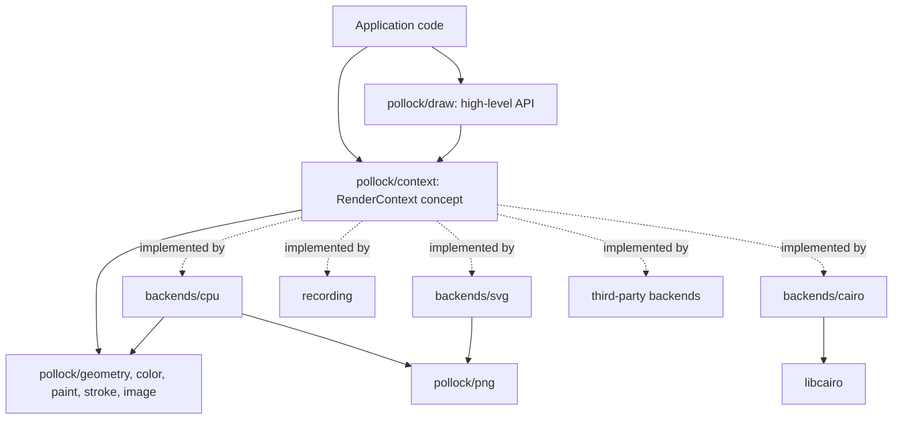

# Architecture

For people working on pollock itself. The [AGENTS.md](https://github.com/playforge-coding/pollock/blob/main/AGENTS.md) file in the repository is the short version and the rules.

## Layers

- The **value types** know nothing about backends: `geometry` (points, rectangles, shapes, affine transforms, Bezier paths, flattening), `color`, `paint`, `stroke` (styles and stroke expansion) and `image`.
- `context` defines the `RenderContext` concept, the ten primitives every backend implements, and re-exports the value types so a backend imports one module.
- `draw` is the high-level API, generic over any `RenderContext`. It is the only layer most users touch.
- Backends implement the concept. Each one is a module under `backends/`, except `recording`, which is part of the core because tests of the high-level API need it.
- `samples` and `testing` exist for conformance: scenes every backend renders, and image comparison.
- `pollock.nim` re-exports `draw` and `png` and imports one backend, chosen by the `pollockBackend` define through a macro that turns the define's module path into an `import` and `export`.

## Why a concept

A concept gives static dispatch: `fill[C: RenderContext](ctx: var C, ...)` is instantiated per backend, and the backend's `fillPath` is called directly. There is no vtable, no `ref object` hierarchy and no runtime cost over calling the backend by hand, and a backend can be defined in any package, since the concept only asks for procs with the right signatures. The price is that drawing code has to be generic (or import one concrete backend), and that concept mismatch errors are less readable than inheritance errors; the `static: doAssert X is RenderContext` at the end of every backend catches mistakes early where the message is clearest.

The primitives are named `fillPath`, `strokePath` and `clipPath` rather than `fill`, `stroke` and `clip` so that the generic helpers in `draw` can carry the short names without the concept ever matching the helpers themselves.

## The CPU rasterizer

`backends/cpu.nim` keeps the picture as premultiplied RGBA `float32`, four per pixel, and converts to 8-bit straight alpha in `toImage`.

Filling a path:

1. Transform the path to device space and flatten it with `tolerance` (0.1 pixel by default).
2. For every edge of every polyline, add its signed area contribution to an accumulation buffer with `width + 2` cells per row (`accumulateLine`, after font-rs). Edges are first split where they cross the left and right borders, and the parts outside become vertical edges on the border so that their winding still counts for the pixels inside. Rows outside the target are skipped.
3. Walk each row with a running sum. The sum is the integral of the winding number over the pixel, which `coverage` turns into 0..1 for either fill rule. Only the columns from the left edge of the bounds to one past the right edge are cleared and scanned: the sum is zero to the left of them and back to zero to the right, since every polyline is closed.
4. Multiply by the clip mask, sample the shader for the pixel center and composite with source-over.

A `Shader` is a paint resolved for one fill: solid color, linear or radial gradient with the inverse transform, or an image with its destination rectangle. `strokePath` expands the stroke in user space with `strokeOutline`, with the tolerance divided by the transform's `maxScale` (its largest singular value, so the error bound holds along the most stretched axis), then fills the outline with the nonzero rule. `clipPath` rasterizes a coverage mask with the same machinery and multiplies in the existing mask; masks are immutable `ref`s shared between saved states.

## Stroke expansion

`stroke.nim` turns a stroke into a union of simple pieces: one quad per segment, a join piece at each interior vertex (a disc for round joins, a triangle for bevels, a kite for miters within the limit) and a cap piece at each end of an open polyline. Every piece is emitted with the same winding direction, so filling them all with the nonzero rule gives their union. Dashing happens before expansion, on the flattened polylines.

## The SVG writer

Each primitive becomes one element with the current transform as a `matrix(...)` attribute, so there is no transform state to track in the output and the coordinates in the document are the user's own. Clips are the exception: they open a `<g clip-path>`, and the state keeps the ids of the open groups. `restore` closes the groups opened since the matching `save`, and `clear` closes all of them around its rectangle and reopens them after, since an SVG element can't escape a clip on an enclosing group any other way.

## The Cairo backend

`backends/cairo.nim` is the first native backend and the pattern for the others. Its bindings are hand-written and cover only what the backend calls: opaque `ptr` types for `cairo_t`, `cairo_surface_t` and `cairo_pattern_t`, `cairo_matrix_t` as a `bycopy` object, enum values as `cint` constants, and the procs with `importc` and `header: "cairo.h"`. The compiler flags come from `pkg-config --cflags cairo` and `pkg-config --libs cairo` at compile time through `gorgeEx`, and a missing Cairo is a compile error with the message from `pkg-config`. The context owns its handles with `=destroy` (`cairo_destroy`, `cairo_surface_destroy`) and has `=copy` disabled.

The transform is kept in Nim, as in the other backends, and set on the cairo_t before every drawing call (`applyTransform`), which is what lets a singular transform be skipped instead of poisoning the cairo_t. That also keeps `currentTransform` relative to the point where a wrapped cairo_t was taken over: the cairo_t's matrix at that moment is stored as the base, and the matrix set before drawing is `base * transform`. The clip is the one piece of state Cairo keeps for us, through `cairo_save` and `cairo_restore`. Patterns are created, set as the source and released per call; Cairo fixes a pattern's user space when it becomes the source, so `setSource` always runs after `applyTransform`.

## PNG

`png.nim` is a complete, dependency-free PNG codec for 8-bit images. The encoder writes stored (uncompressed) deflate blocks, since speed and simplicity matter more than size for test output; the decoder has a full inflate so it can read PNGs from anywhere. Since `readPng` takes arbitrary files, malformed input raises `PngError` rather than a defect: the IHDR chunk's length and dimensions are checked, and inflation stops once the output passes the size the header implies, so a few megabytes of crafted data can't expand into gigabytes. It exists so the CPU backend can save its output and the SVG backend can embed images on every target, including JavaScript, where there is no zlib to link.

## Targets

Everything in `src/` except the native backends compiles under `nim c`, `nim objc` and `nim js`, and the tests run under C and JavaScript in CI. Rules that keep it that way:

- No `ptr`, `addr` or `cast` of memory in the core or the pure-Nim backends. Pixel buffers are `seq[uint8]` or `seq[float32]`.
- A native backend compiles for the targets its [table row](backends.md) names and uses `ptr` for the library's handles. Its test file is a no-op without the backend's define (`-d:pollockCairo`), so `nimble test` and `nimble testjs` run on every machine, and a task (`nimble testcairo`) runs it with the define.
- File I/O is wrapped in `when not defined(js)`.
- The JavaScript backend evaluates a `case` selector once per branch. Bind a selector with side effects to a `let` first; `png.nim` does this for the deflate block type.
- Unsigned integer arithmetic behaves the same on both targets, as do the `shl` and `shr` operators on `uint32`, so checksums and bit readers are fine to write plainly.
- `int` is 32 bits on JavaScript for range and overflow checks. Converting a `uint32` above 2^31 - 1 to `int` raises there, so check the unsigned value first, and compute sizes that could be large in `float64`. `png.nim` does both for the image dimensions.
