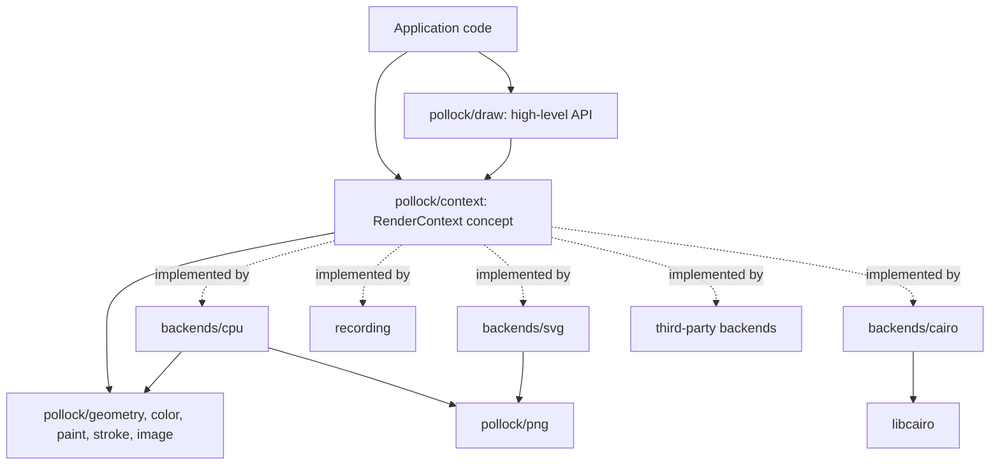
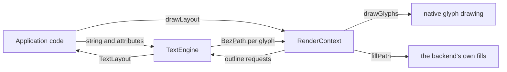

# Architecture

For people working on pollock itself. The [AGENTS.md](https://github.com/playforge-coding/pollock/blob/main/AGENTS.md) file in the repository is the short version and the rules.

## Layers

- The **value types** know nothing about backends: `geometry` (points, rectangles, shapes, affine transforms, Bezier paths, flattening), `color`, `paint`, `stroke` (styles and stroke expansion) and `image`.
- `context` defines the `RenderContext` concept, the ten primitives every backend implements, and re-exports the value types so a backend imports one module.
- `draw` is the high-level API, generic over any `RenderContext`. It is the only layer most users touch.
- Backends implement the concept. Each one is a module under `backends/`, except `recording`, which is part of the core because tests of the high-level API need it.
- `samples` and `testing` exist for conformance: scenes every backend renders, and image comparison.
- `pollock.nim` re-exports `draw` and `png` and imports one backend, chosen by the `pollockBackend` define through a macro that turns the define's module path into an `import` and `export`.

## Why a concept

A concept gives static dispatch: `fill[C: RenderContext](ctx: var C, ...)` is instantiated per backend, and the backend's `fillPath` is called directly. There is no vtable, no `ref object` hierarchy and no runtime cost over calling the backend by hand, and a backend can be defined in any package, since the concept only asks for procs with the right signatures. The price is that drawing code has to be generic (or import one concrete backend), and that concept mismatch errors are less readable than inheritance errors; the `static: doAssert X is RenderContext` at the end of every backend catches mistakes early where the message is clearest.

The primitives are named `fillPath`, `strokePath` and `clipPath` rather than `fill`, `stroke` and `clip` so that the generic helpers in `draw` can carry the short names without the concept ever matching the helpers themselves.

## The CPU rasterizer

`backends/cpu.nim` keeps the picture as premultiplied RGBA `float32`, four per pixel, and converts to 8-bit straight alpha in `toImage`.

Filling a path:

1. Transform the path to device space and flatten it with `tolerance` (0.1 pixel by default).
2. For every edge of every polyline, add its signed area contribution to an accumulation buffer with `width + 2` cells per row (`accumulateLine`, after font-rs). Edges are first split where they cross the left and right borders, and the parts outside become vertical edges on the border so that their winding still counts for the pixels inside. Rows outside the target are skipped.
3. Walk each row with a running sum. The sum is the integral of the winding number over the pixel, which `coverage` turns into 0..1 for either fill rule. Only the columns from the left edge of the bounds to one past the right edge are cleared and scanned: the sum is zero to the left of them and back to zero to the right, since every polyline is closed.
4. Multiply by the clip mask, sample the shader for the pixel center and composite with source-over.

A `Shader` is a paint resolved for one fill: solid color, linear or radial gradient with the inverse transform, or an image with its destination rectangle. `strokePath` expands the stroke in user space with `strokeOutline`, with the tolerance divided by the transform's `maxScale` (its largest singular value, so the error bound holds along the most stretched axis), then fills the outline with the nonzero rule. `clipPath` rasterizes a coverage mask with the same machinery and multiplies in the existing mask; masks are immutable `ref`s shared between saved states.

## Stroke expansion

`stroke.nim` turns a stroke into a union of simple pieces: one quad per segment, a join piece at each interior vertex (a disc for round joins, a triangle for bevels, a kite for miters within the limit) and a cap piece at each end of an open polyline. Every piece is emitted with the same winding direction, so filling them all with the nonzero rule gives their union. Dashing happens before expansion, on the flattened polylines.

## The SVG writer

Each primitive becomes one element with the current transform as a `matrix(...)` attribute, so there is no transform state to track in the output and the coordinates in the document are the user's own. Clips are the exception: they open a `<g clip-path>`, and the state keeps the ids of the open groups. `restore` closes the groups opened since the matching `save`, and `clear` closes all of them around its rectangle and reopens them after, since an SVG element can't escape a clip on an enclosing group any other way.

## The Cairo backend

`backends/cairo.nim` is the first native backend and the pattern for the others. Its bindings are hand-written and cover only what the backend calls: opaque `ptr` types for `cairo_t`, `cairo_surface_t` and `cairo_pattern_t`, `cairo_matrix_t` as a `bycopy` object, enum values as `cint` constants, and the procs with `importc` and `header: "cairo.h"`. The compiler flags come from `pkg-config --cflags cairo` and `pkg-config --libs cairo` at compile time through `gorgeEx`, and a missing Cairo is a compile error with the message from `pkg-config`. The context owns its handles with `=destroy` (`cairo_destroy`, `cairo_surface_destroy`) and has `=copy` disabled. The hook is declared twice under `when defined(gcDestructors)`: ORC and ARC take the Nim 2 signature `=destroy(x: T)`, and refc only accepts the older `=destroy(x: var T)`, so a program built with `--mm:refc` would otherwise fail to compile. `nimble testcairo` runs the tests under both.

The transform is kept in Nim, as in the other backends, and set on the cairo_t before every drawing call (`applyTransform`), which is what lets a singular or non-finite transform be skipped instead of poisoning the cairo_t. Every drawing call except `clipPath` runs inside a `cairo_save`/`cairo_restore` pair, so the matrix, source and line settings it sets don't outlive it; `clipPath` puts the matrix and fill rule back by hand, since its clip has to stay. That also keeps `currentTransform` relative to the point where a wrapped cairo_t was taken over: the cairo_t's matrix at that moment is stored as the base, and the matrix set before drawing is `base * transform`. The clip is the one piece of state Cairo keeps for us, through `cairo_save` and `cairo_restore`. Patterns are created, set as the source and released per call; Cairo fixes a pattern's user space when it becomes the source, so `setSource` always runs after `applyTransform`.

## PNG

`png.nim` is a complete, dependency-free PNG codec for 8-bit images. The encoder writes stored (uncompressed) deflate blocks, since speed and simplicity matter more than size for test output; the decoder has a full inflate so it can read PNGs from anywhere. Since `readPng` takes arbitrary files, malformed input raises `PngError` rather than a defect: the IHDR chunk's length and dimensions are checked, and inflation stops once the output passes the size the header implies, so a few megabytes of crafted data can't expand into gigabytes. It exists so the CPU backend can save its output and the SVG backend can embed images on every target, including JavaScript, where there is no zlib to link.

## Targets

Everything in `src/` except the native backends compiles under `nim c`, `nim objc` and `nim js`, and the tests run under C and JavaScript in CI. Rules that keep it that way:

- No `ptr`, `addr` or `cast` of memory in the core or the pure-Nim backends. Pixel buffers are `seq[uint8]` or `seq[float32]`.
- A native backend compiles for the targets its [table row](backends.md) names and uses `ptr` for the library's handles. Its test file is a no-op without the backend's define (`-d:pollockCairo`), so `nimble test` and `nimble testjs` run on every machine, and a task (`nimble testcairo`) runs it with the define.
- File I/O is wrapped in `when not defined(js)`.
- The JavaScript backend evaluates a `case` selector once per branch. Bind a selector with side effects to a `let` first; `png.nim` does this for the deflate block type.
- Unsigned integer arithmetic behaves the same on both targets, as do the `shl` and `shr` operators on `uint32`, so checksums and bit readers are fine to write plainly.
- `int` is 32 bits on JavaScript for range and overflow checks. Converting a `uint32` above 2^31 - 1 to `int` raises there, so check the unsigned value first, and compute sizes that could be large in `float64`. `png.nim` does both for the image dimensions.

## Text (planned)

None of this is written yet. It is the design, settled first so that the text code and the backends can be built independently of each other.

### Layout and drawing are separate

Drawing text is two jobs that don't depend on each other:

- **Layout**: finding fonts and fallbacks, shaping, bidirectional text, line breaking, metrics and hit testing. The result is positioned glyphs.
- **Glyph drawing**: turning those glyphs into pixels or document elements.

A **text engine** does layout and a backend does the drawing. They meet at a `GlyphRun`: one font at one size in one paint, and a list of glyph ids with their positions. A run carries nothing specific to a library, so any engine can feed any backend that runs on the same platform. Each of the two sets stays open, like the backend set is today: a package can add an engine without touching any backend, and the other way around.

### The pieces

- **`TextEngine`**, a concept in `pollock/text`. An engine loads fonts from bytes and builds a `TextLayout` from a string with ranged attributes (family, size, weight, style, paint and so on). For a layout, it answers with the glyph runs, line metrics and hit testing. For any glyph, it gives a `GlyphDrawing` (below). The concept is kept as small as `RenderContext` and grows by the same rule, only when every engine can implement the addition.
- **`GlyphRun`**: the engine's handle for a font, the size, the paint, and the glyphs as (id, x, y) in user space, with y on the baseline. The font handle resolves to the font's bytes, face index and variation coordinates. A layout splits its runs wherever the font, the size or the paint changes, so each run has exactly one paint, the one its range of the text was given.
- **`GlyphDrawing`**: what one glyph looks like, as a case object over `GlyphKind`. `gkOutline` holds a `BezPath`. `gkLayers` holds a list of outlines, each with its own `Paint` or a flag that says to use the run's paint (the COLR "foreground color"). `gkBitmap` holds an `ImageData` and the rectangle it covers. Paths and rectangles are in font units, and the drawing code scales them by the run's size.
- **One new primitive**, `drawGlyphs(ctx, run, paint)`. The paint is passed explicitly, like every other paint in the contract, so code can draw a run in another paint (a shadow, a highlight). A helper in `draw` draws a whole layout at a point, calling the primitive for each run with that run's own paint.
- **Backends are generic over the engine.** The context keeps the engine it was made with (shared with the layouts and any other contexts) so it can ask for outlines. Each pairing gets a type alias, and `CpuContext` keeps meaning the all-Nim one. Because the engine is a type parameter, a backend picks its native path at compile time: `when T is PangoEngine` in the Cairo backend can draw Pango's runs through `pango_cairo_show_glyph_string`.
- **A second define**, `pollockTextEngine`, next to `pollockBackend`, picks the engine for the default context that `import pollock` exports.

### Drawing a run

Every backend can draw a run without native text support. It asks the engine for each glyph's `GlyphDrawing` and draws it with primitives it already has: an outline with `fillPath` in the paint given to `drawGlyphs`, each layer with `fillPath` in the layer's paint (or the given one), and a bitmap with `drawImage` into its rectangle. A shared cache in pollock keeps the drawings in font units, keyed by font and glyph id, and scales them per run. That fallback is why `drawGlyphs` can be part of the concept from the first release: every backend, the recording one included, can implement it.

A backend with native glyph drawing uses it when it can make a native font from the run's font bytes:

| Backend | How it draws a run |
| --- | --- |
| CPU, tiny-skia, vello_cpu | Outlines filled as paths. |
| SVG | One path per glyph. `<text>` elements may come later as an option, for selectable text, at the price of the viewer doing its own layout. |
| Cairo | Pango's runs through `pango_cairo_show_glyph_string`; runs from other engines through `cairo_show_glyphs`, with a FreeType face made from the bytes. |
| Core Graphics | Core Text's runs through `CTFontDrawGlyphs`; for other engines, a `CGFont` made from the bytes with `CGFontCreateWithDataProvider`. |
| Direct2D | `DrawGlyphRun`; fonts from other engines are loaded through the in-memory font file loader of `IDWriteFactory5`. |
| WebGL2 | Outlines rasterized into a glyph atlas texture. |
| Recording | Records the run. |

Color glyphs (emoji and other color fonts) aren't plain outlines, which is what the layer and bitmap kinds of `GlyphDrawing` are for. COLRv0 glyphs become `gkLayers` with solid paints. sbix and CBDT glyphs become `gkBitmap`, with the engine picking the bitmap strike closest to the run's size. COLRv1 adds gradients, including sweep gradients, and blend modes. Its linear and radial gradients map onto pollock's paints, but pollock has neither sweep gradients nor blend modes yet, so until it does an engine gives a COLRv1 glyph that needs them as its plain outline (`gkOutline`). Glyphs stored as SVG documents are not planned. A backend that draws color glyphs natively (Core Text, DirectWrite's color glyph runs) may do so instead of the fallback.

### Contract additions

- Glyph positions are in user space, and the transform applies to them as it does to a path.
- A font is its bytes, face index and variation coordinates, never a system handle, so any backend can build its own native font from it.
- Font lookup and fallback belong to the engine. Parley on Core Graphics finds fonts the way Parley does, not the way Core Text does.
- Glyphs are drawn unhinted with grayscale antialiasing, so every pairing can be compared with the reference. Hinting may come later as an option that a backend is allowed to ignore.

### Engines and backends

Every pairing on one platform works. The cells say which part does the drawing and which does the layout:

| Backend | Pure Nim | Parley | Pango | Core Text | DirectWrite |
| --- | --- | --- | --- | --- | --- |
| CPU (pure Nim) | all Nim (the reference) | Nim drawing, Parley layout | Nim drawing, Pango layout | Nim drawing, Core Text layout | Nim drawing, DirectWrite layout |
| tiny-skia | tiny-skia drawing, Nim layout | all Rust | tiny-skia drawing, Pango layout | tiny-skia drawing, Core Text layout | tiny-skia drawing, DirectWrite layout |
| vello_cpu | vello_cpu drawing, Nim layout | all Rust, all Linebender | vello_cpu drawing, Pango layout | vello_cpu drawing, Core Text layout | vello_cpu drawing, DirectWrite layout |
| Cairo | Cairo drawing, Nim layout | Cairo drawing, Parley layout | the GTK stack | Cairo drawing, Core Text layout | Cairo drawing, DirectWrite layout |
| Core Graphics | Core Graphics drawing, Nim layout | Core Graphics drawing, Parley layout | Core Graphics drawing, Pango layout | all Apple APIs | not possible |
| Direct2D | Direct2D drawing, Nim layout | Direct2D drawing, Parley layout | Direct2D drawing, Pango layout | not possible | all Windows APIs |
| SVG | glyph paths, Nim layout | glyph paths, Parley layout | glyph paths, Pango layout | glyph paths, Core Text layout | glyph paths, DirectWrite layout |
| WebGL2 | glyph atlas, Nim layout | not on JS | not on JS | not on JS | not on JS |

Where each one runs:

- Core Text and Core Graphics exist only on Apple platforms, and DirectWrite and Direct2D only on Windows, which is why those pairings are not possible.
- Pango comes with Linux desktops and installs on macOS (Homebrew) and Windows (MSYS2). It needs a font map, from `pangocairo` or `pangoft2`, so it brings in Cairo or FreeType even when Cairo doesn't draw. A backend other than Cairo gets the outlines and the font bytes from Pango's HarfBuzz font (`pango_font_get_hb_font`, then `hb_font_draw_glyph` and `hb_face_reference_blob`).
- Parley does the layout. Font discovery and fallback come from fontique, and outlines from skrifa. One package wraps all three.
- On the JavaScript target only the pure Nim engine runs, with the CPU, SVG and WebGL2 backends. Once the HarfBuzz shaper exists, it will cover every script there by shaping with HarfBuzz compiled to WebAssembly (see [the pure Nim engine](#the-pure-nim-engine)). The Rust parts build for `c` and `objc`; a WebAssembly build of Parley is possible later but not planned. The browser's own text can't be an engine (see [what was ruled out](#ruled-out)), so WebGL2 draws the pure Nim engine's glyphs through an atlas.

### Where the code lives

- In pollock: the `TextEngine` concept, `GlyphRun`, `GlyphDrawing` and the glyph cache in `pollock/text`, and the engines under `pollock/engines/`: `opentype` (pure Nim, the default), `pango`, `coretext` and `directwrite`. The native engines follow the rules for native backends: their own define and guarded test file, a `nimble` task, and nothing in the core imports them.
- In separate packages, because they need Rust: `pollock-parley` (an engine), `pollock-tinyskia` and `pollock-vellocpu` (backends). Each has a small crate that exposes a C ABI over the library: opaque handles that Nim frees from `=destroy`, plain `repr(C)` types at the boundary, coarse calls (a whole layout in, flat arrays of runs out), and no unwinding across it (`panic = "abort"`, or `catch_unwind` turned into a status code that `finish` reports). cbindgen writes the C header from `build.rs`, the Nim bindings use it through `importc` and `header`, as the Cairo backend does with `cairo.h`, and the package's `nimble` tasks run `cargo build` first.

### The CPU family

The pure Nim renderer, tiny-skia and vello_cpu all render into memory and read the picture back. A small `RasterContext` concept (`RenderContext` plus `width`, `height`, `toImage` and `pixel`) lets the example window, `tools/rendersamples.nim` and the tests take any of them, and Cairo's offscreen contexts satisfy it too. It may later gain a way to hand over the pixels without a copy for texture uploads, since tiny-skia's pixmap is already premultiplied 8-bit RGBA and the pure Nim backend converts from `float32`.

### Testing text

The reference pairing, the CPU backend with the pure Nim engine, gets exact goldens for text samples drawn with an openly licensed font kept in `tests/`. Every other pairing is compared with those goldens at a tolerance, the way `tcairo` compares Cairo today, looser for text than for shapes. CI runs the pairings whose libraries install on each platform.

### The pure Nim engine

It covers OpenType parsing (`cmap`, `glyf`, CFF and CFF2 outlines, metrics, variations), the Unicode bidirectional algorithm (UAX 9) and line breaking (UAX 14), with the Unicode data generated into Nim tables, and shaping. Fonts come from the application as bytes; looking up installed fonts works off the JavaScript target only.

Shaping is the one part that is hard to finish: Arabic joining, Indic reordering and the other complex scripts take years of work to get right. So it sits behind a seam of its own inside the engine. The engine takes a **shaper**, which turns a run of text in one font, script and direction into glyph ids with advances and offsets:

- **The Nim shaper**, the default. It applies GSUB and GPOS and starts with what Latin, Greek and Cyrillic need: ligatures, kerning and mark placement. Complex scripts come later.
- **HarfBuzz.** On `c` and `objc` it is the native library, found through `pkg-config` (it is installed wherever Pango is). On the JavaScript target it is [harfbuzzjs](https://github.com/harfbuzz/harfbuzzjs), HarfBuzz's own WebAssembly build, which runs in browsers and in Node, so `nimble testjs` can test it. Both take the font's bytes, so the engine's fonts and runs stay the same whichever shaper is used.

Once the HarfBuzz shaper is written, the pure Nim engine will handle every script on every target, and the Nim shaper can take over script by script as it grows. The application will load harfbuzzjs itself and pass the instance in, so pollock keeps no dependencies on JS either. Instantiating WebAssembly is asynchronous, so on JS the engine will be made from an instance that is already loaded and will never wait inside a constructor. The shaper module will follow the rules for native code: its own define (`pollockHarfBuzz`), a test file that skips itself without it, and a `nimble` task that runs it under C and Objective-C and, with harfbuzzjs installed from npm, under JS.

### Ruled out

- **Canvas 2D text as an engine.** `measureText` gives widths and `fillText` draws strings, but neither gives glyph ids or outlines, so its layouts can't become glyph runs.
- **[pretext](https://github.com/chenglou/pretext).** It breaks lines quickly by measuring text segments with Canvas 2D and returns lines of text for `fillText` to draw, so it has the same limits as Canvas 2D text: no glyph runs, so the CPU and SVG backends couldn't draw its output and nothing could clip to it. It also needs a canvas to measure with, which Node doesn't have, so the JavaScript tests couldn't run it. It fits a page laid out by the browser, not pollock's model. A Canvas 2D backend that draws strings could use it someday as a separate kind of text, outside the glyph run model.
- **All of Parley in WebAssembly as the answer for JS.** It would work, but it is a much bigger download than HarfBuzz and needs a JS glue layer, while the gap it would fill on JS is mostly shaping, which HarfBuzz covers alone.
