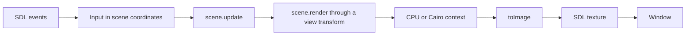

# Examples

The `examples/` directory has five interactive scenes that run live in a native window. Each one is ordinary pollock drawing code, generic over `RenderContext`, so the same scene draws through the CPU backend, through Cairo, or into an SVG file.

pollock itself never opens windows. The example window gets one from [SDL3](https://libsdl.org) through the official [`sdl3`](https://github.com/nim-lang/sdl3) Nim package, draws each frame with a pollock backend into pixels, and hands them to SDL as a texture.

## Running them

Install SDL3:

| Platform | Command |
| --- | --- |
| macOS | `brew install sdl3` |
| Ubuntu 25.04 and later, Debian 13 | `sudo apt install libsdl3-dev` |
| Fedora | `sudo dnf install SDL3-devel` |
| Arch | `sudo pacman -S sdl3` |
| Windows | Download `SDL3-<version>-win32-x64.zip` from [SDL's releases](https://github.com/libsdl-org/SDL/releases) and put `SDL3.dll` on the `PATH`. |

Then, from a checkout of pollock:

```sh
nimble window
```

The first run calls `nimble setup`, which fetches the `sdl3` package at the version pinned in `nimble.lock` and writes `nimble.paths` so the compiler finds it. The `sdl3` package is a development dependency: installing pollock as a library doesn't pull it in.

To start on a particular scene, run the program directly and name it:

```sh
nim r -d:release examples/window.nim gears
```

The scenes are `orrery`, `fireworks`, `beziers`, `gears` and `flowfield`.

### Keys

| Key | Action |
| --- | --- |
| 1 to 5, Left, Right | Switch scenes. |
| Space | Pause. |
| R | Restart the scene. |
| H | Toggle between drawing at the window's size in points and drawing every pixel of a high-density screen. |
| B | Switch between the CPU and Cairo backends (when built with `-d:pollockCairo`, which `nimble window` passes when `pkg-config` finds Cairo). |
| S | Save the frame as `out/<scene>.png` (twice the scene's size, from the CPU backend) and `out/<scene>.svg`. |
| Escape | Quit. |

The title bar shows what the pointer does in the current scene, the backend, the size being drawn and the time each frame takes.

## The scenes

**Orrery** (`orrery.nim`). A small solar system seen at an angle. Moving the pointer up and down tilts the view, and left and right changes how fast time runs. Radial gradients light the sun's glow and the sunward side of each planet, a clip confines each planet's night-side shadow to its disc, nested transforms and clips put half of the ringed planet's ring behind it and half in front, and the bodies are sorted by depth every frame. A comet's tail grows near the sun and trails behind its motion, built from layered translucent fills.

**Fireworks** (`fireworks.nim`). Rockets launch on their own; clicking sends one to burst at the pointer, and holding the button lights a sparkler there. It is a particle simulation with up to 1500 sparks drawn fresh every frame as short strokes with round caps, flashes as radial gradients, and a skyline built once as a single path.

**Bezier curves** (`beziers.nim`). Drag the four control points of a cubic curve. De Casteljau's construction runs along the curve, showing the three levels of interpolation, the part of the curve up to the current parameter (split off with the construction's own points), the tangent, and the osculating circle computed from the derivatives. The dots along the curve are the vertices `flatten` picks, closer together where the curve bends harder, and the control polygon's dashes march by animating `dashOffset`.

**Gears** (`gears.nim`). A train of seven meshing gears. Drag any gear to turn the whole train; let go and it keeps spinning, then settles back to its idle speed. The teeth are generated paths with quadratic curves at the tips and roots, the axle holes and spoke windows are cut with the even-odd fill rule, and each gear's path is transformed in user space so its lighting gradient stays put while the gear turns. Each gear's angle is a linear function of the driving gear's, worked out when the train is built so the teeth interlock.

**Flow field** (`flowfield.nim`). Particles drift through a slowly changing field, each leaving a trail that fades from tail to head with a linear gradient and takes its color from the direction of travel. The pointer stirs a whirlpool into the field, and holding the button turns it into a drain.

## How it fits together

Each scene is an object with two procedures:

```nim
proc update*(s: var Orrery, dt: float64, input: Input)
proc render*[C: RenderContext](s: Orrery, ctx: var C)
```

`update` advances the scene by `dt` seconds. `Input` (in `examples/scene.nim`) carries the pointer in scene coordinates: where it is, whether it is over the scene, whether a button is down, and whether the press started this frame. `render` draws the scene in a 640 by 400 coordinate space, covering it with an opaque background first. `examples/scenes.nim` puts all of them behind one `Scene` type so a host can switch between them at run time.



The window maps the scene into whatever size the window is with a transform: as large as it fits, centered, with bars painted over the space left around it. Pointer positions go back through the inverse of the same transform.

The CPU backend is the reference renderer, written to be exact rather than fast, so by default the window draws at its size in points and lets SDL scale the texture up on a high-density screen. At that size (960 by 600 for the default window) the scenes take 10 to 17 milliseconds a frame on the CPU backend on an Apple M-series laptop, so they keep up with a 60 Hz display or come close, and Cairo is faster still. Press H to draw every pixel.

The same scenes run without a window in `tests/texamples.nim`, under the C and JavaScript targets: every scene draws on the CPU, SVG and recording backends, moves on its own, reacts to a scripted pointer, and starts the same way every time.

## Writing a scene

A scene needs an object, a constructor, `update` and `render`:

```nim
import std/math
import scene

type Pulse* = object
  time: float64
  at: Point

func newPulse*(): Pulse =
  Pulse(at: point(sceneWidth / 2, sceneHeight / 2))

proc update*(s: var Pulse, dt: float64, input: Input) =
  s.time += dt
  if input.inside:
    s.at = input.pos

proc render*[C: RenderContext](s: Pulse, ctx: var C) =
  ctx.fill(sceneBounds, rgb8(20, 20, 30))
  let r = 30 + 10 * sin(s.time * 4)
  ctx.fill(circle(s.at, r), hsl(s.time * 0.1, 0.7, 0.6))
```

To show it in the window, import it in `examples/scenes.nim` and add it to `SceneKind`, the `Scene` object and the `case` statements there. The test suite picks it up from `SceneKind` on its own.
